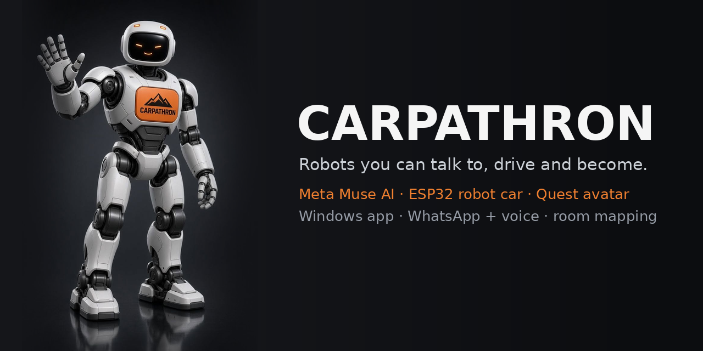

<p align="center">
  
</p>

# Carpathron

**Robots you can talk to, drive and become.** Carpathron connects a small ESP32 camera robot to **Meta's Muse
models**, a **Windows AI agent**, **WhatsApp (text + voice)**, the **browser**, and a native **Meta Quest 3S
avatar app**. One brain (Muse), one open robot protocol, every way you want to reach your robot.

Built for the **Meta Global AI Developer Hackathon 2026 — Startup track**.

| | What it is | Where |
|---|---|---|
| 🧠 **Muse Carpathron** | Windows desktop app: chat + agent on **Meta Muse** (Muse Spark / Wonder via the Meta Model API, or your Meta account via **Muse Code**) with full PC access, **SSH servers**, documents & designed PDFs, web research, **Arduino/ESP32 firmware**, Muse Image, SAM 3.1, MCP, sub-agents, RAG memory, projects, skills, WhatsApp remote, robot control, room mapping, browser VR | [`apps/desktop`](apps/desktop) |
| 🥽 **Carpathron Avatar** | Native **Meta Quest** app (OpenXR, Godot): see through the robot's eyes, drive with the controllers, turn your head and the robot turns with you, talk to Muse | [`apps/quest-avatar`](apps/quest-avatar) |
| 🚗 **Baby Carpathron firmware** | ESP32-CAM car (KUONGSHUN AD174 4WD kit): live video, drive, photo, Wi-Fi setup, RC-style control | [`firmware/carpathron_car`](firmware/carpathron_car) |
| 🔌 **Carpathron Robot Protocol** | Small open HTTP protocol: any robot that speaks it works with every app | [`protocol/ROBOT-PROTOCOL.md`](protocol/ROBOT-PROTOCOL.md) |
| 📘 **Complete guide** | From install to every menu, tool, SSH, GitHub, MCP, firmware, robot, WhatsApp, Quest — also built into the app (**📖 Guide & help**) | [`docs/GUIDE.md`](docs/GUIDE.md) |

## ⬇️ Download

<p align="center">
  <a href="https://github.com/qubitpage/carpathron-muse/releases/latest/download/Muse-Carpathron-Setup.exe"></a>
  <a href="https://github.com/qubitpage/carpathron-muse/raw/main/downloads/quest/CarpathronAvatar-1.1.4.apk"></a>
</p>

| App | Download | How to install |
|---|---|---|
| 🧠 **Muse Carpathron** – Windows 10 / 11 / Server 2016+ (v1.5.4) | [**Muse-Carpathron-Setup.exe**](https://github.com/qubitpage/carpathron-muse/releases/latest/download/Muse-Carpathron-Setup.exe) | Double-click it. If SmartScreen appears: *More info → Run anyway*. The app opens when the install finishes. |
| 🥽 **Carpathron Avatar** – Meta Quest 3 / 3S / Pro / 2 (v1.1.4) | [**CarpathronAvatar-1.1.4.apk**](https://github.com/qubitpage/carpathron-muse/raw/main/downloads/quest/CarpathronAvatar-1.1.4.apk) | Developer Mode on the headset → Meta Quest Developer Hub → *Device manager → Add build* → open it from *Library → Unknown Sources*. The Meta Horizon Store version is in review. |
| 🚗 **Baby Carpathron** – ESP32-CAM car firmware | [`firmware/carpathron_car`](firmware/carpathron_car) | Arduino IDE, esp32 core 2.0.x, board *AI Thinker ESP32-CAM* – see [CAR-SETUP](firmware/carpathron_car/CAR-SETUP.md). |

All files of this version: **[Release v1.5.4](https://github.com/qubitpage/carpathron-muse/releases/tag/v1.5.4)** (all releases: [Releases](https://github.com/qubitpage/carpathron-muse/releases)) · alternative split installer (5 parts + `Install.bat`) in [`downloads/windows`](downloads/windows) · install notes in [`downloads/README.md`](downloads/README.md).

## What's new in 1.5.4

- **GitHub sign-in with the browser, reworked:** the app downloads the official GitHub CLI by itself (into its own folder — no admin rights, no winget, no extra window), shows the one-time code in the app (already copied) and opens the GitHub page. Authorize and it connects. A `GH_TOKEN` set on the PC no longer blocks the login.
- **MCP servers that work out of the box:** `filesystem`, `memory` (knowledge graph) and `sequential-thinking` ship with the app and run on its built-in runtime — no Node.js needed. They are set up automatically and work with **both engines** (Meta API key and Muse Code). Your own servers (`npx`, `uvx`, remote URL) work as before; errors now say clearly what is missing.

### 1.5.3

- **📖 Guide & help** (bottom left): the complete documentation inside the app — install from scratch, connecting Meta (API key or Muse Code), every menu and button, all agent tools, remote servers and SSH keys, GitHub, MCP servers, Arduino, the robot, WhatsApp, phone and Quest, troubleshooting. Searchable, with a contents list. Same text in [`docs/GUIDE.md`](docs/GUIDE.md).
- **No duplicate servers:** a server is one entry per *user + host + port*. Adding it again (by you or by the agent) updates the saved entry instead of making a copy; duplicates saved by older versions are merged at start, keeping the credentials, and their chats move to the kept entry.

### 1.5.2

- **Sign in to GitHub with the browser** (Plugins → GitHub): uses the GitHub CLI web login when it is installed, or the GitHub device code page. No token to copy.
- **Server chats are saved.** A chat started on a remote server keeps that server, so you can come back another day and continue there. Chats on a server show 🌐 in the list.
- **Terminal sessions are saved as chats** (⌨ in the list). Open one later to read what was run, ask the agent to continue, or press *Continue in terminal*.

### 1.5.1

- Muse Code sessions now get the app tools (SSH, GitHub, PDF, research, Arduino, robot…) — tested on Windows with Muse Code 1.4.14, also in Full mode.
- Muse Code can no longer get stuck waiting for a question dialog the app cannot show.

### 1.5.0

- **Remote** page (left menu): all your servers with live status, **terminal** in the app, Test / Disconnect, **Chat here** (new chat working on that server), edit and delete.
- **SSH keys:** generate ed25519 keys (stored encrypted), import existing keys, copy the public key, export to `.ssh`, and **Install key** on a server — it adds the key to `authorized_keys`, switches the server to key login and can remove the saved password.
- **Plugins** page with **GitHub**: connect a token (encrypted), then the agent can create repositories, **publish a folder** (commit + push, author = you), clone, make **releases with installer/APK uploads**, and manage issues and pull requests. New skill `/github-publish` (checks for secrets and a `.gitignore` before pushing).
- **New project** and other dialogs work in the desktop app (they used the browser prompt, which Electron does not support).

### 1.4.1

- **Muse Code commands work on Windows:** Muse Code's app host reported the Windows sandbox as unavailable even after `muse sandbox windows setup`, so every command failed. The app now detects this and runs Muse Code without the sandbox (Settings → Tools & models → *Muse Code Windows sandbox*: Automatic / Always / Off); approvals still apply. *Set up sandbox* now runs the real `muse sandbox windows setup` (the old button failed with "Windows cannot find 'sandbox'").
- Settings page no longer shows duplicated sections.

### 1.4.0

- **Remote servers over SSH:** save a VPS or dedicated server once (password or key, encrypted with your Windows account; host key checked). Switch any chat to a server with **🖥 This PC → my-vps**: files and commands then run on the server. Tools: `ssh_exec`, interactive `ssh_shell` (sudo prompts, REPLs, `tail -f`), `ssh_upload` / `ssh_download`, background jobs on the server.
- **Full access mode:** Ask · Auto · **Full** · Plan. Full runs everything without approvals and picks Muse Code's full-access permission profile when it offers one (no sandbox).
- **Documents:** reads PDF (by page), Word, Excel (all sheets + formulas), PowerPoint. **Designed PDFs** from HTML/CSS or Markdown with the built-in Chromium (`create_pdf`), **page screenshots** at desktop and phone width so the agent can check and fix websites and layouts it builds (`screenshot_page`, `view_image`).
- **Web search + deep research:** Meta search grounding with sources (DuckDuckGo fallback); `deep_research` plans searches, reads the sources and writes a cited Markdown report.
- **Firmware like a developer:** `arduino_setup` (finds Arduino IDE 2's arduino-cli or downloads it, installs ESP32/AVR/RP2040 cores and libraries), `arduino_boards`, `arduino_compile` (errors with file:line), `arduino_upload`, `serial_monitor`, `open_arduino_ide`.
- **Every Muse model, used for what it can do:** the model menu shows each model's capabilities (images, video, audio, PDF, tools, reasoning, web search). **Muse Wonder** and reasoning effort (minimal … max). Pick **Muse Image** to draw or edit pictures, **SAM 3.1** to find objects (boxes + overlay, works on robot photos), **Muse Voice Transcribe** for audio files. Chat models can call them as tools too (`generate_image`, `segment_image`, `transcribe_audio`). Attached images go to vision models as images.
- **Muse Code gets the same tools:** an MCP bridge gives Meta-account sessions the app's SSH, PDF, research, Arduino, image, SAM and robot tools.
- **Stop works every time:** Stop (or Esc) ends the turn within seconds even if the model or a command hangs; long commands are killed.
- **New skills:** `/design-website`, `/design-pdf`, `/research`, `/firmware`, `/server-setup`, `/carpathron-build` (the whole robot → app → Avatar → server process).
- 57 backend tests (35 + 22 new, incl. a real SSH/SFTP test server and the MCP bridge) + Electron tests for PDF, screenshots and overlays.

## How Meta Muse powers every app

| Muse model / tool | Used for | Apps |
|---|---|---|
| **Muse Spark** (Meta Model API) | Chat + agent with tools, sub-agents, vision ("what do you see?"), room-map analysis, auto-memory and auto-skills | Desktop, WhatsApp, Quest |
| **Muse Voice Transcribe** | WhatsApp voice notes and Quest push-to-talk → text → robot commands or the agent | WhatsApp, Quest |
| **Muse Code** (`muse serve`) | Sign in with your Meta account instead of an API key; same chat, tools and approvals (+ app tools via MCP bridge) | Desktop |
| **Muse Wonder** | Hardest reasoning tasks, reasoning effort up to max | Desktop |
| **Muse Image** | Logos, illustrations, website images, image edits | Desktop |
| **SAM 3.1** | Find and outline objects in photos/video (robot vision) | Desktop |

```
              ┌──────────────── Meta Model API ────────────────┐
              │  Muse Spark (chat · tools · vision)            │
              │  Muse Voice Transcribe (speech → text)          │
              └───────────────▲────────────────────────────────┘
                              │ HTTPS
 WhatsApp (text/voice) ──► ┌──┴──────────────────────────┐ ◄── Browser / phone / Quest browser (pairing PIN)
                           │  Muse Carpathron (Windows)   │
 Carpathron Avatar ──────► │  agent · memory · tools · MCP│ ◄── Muse Code (Meta account)
 (Quest, linked once)      └──┬───────────────────────────┘
                              │ Carpathron Robot Protocol (HTTP + MJPEG, LAN)
                       ┌──────▼─────────┐ ◄── Carpathron Avatar can also drive it directly
                       │ Baby Carpathron │
                       │ ESP32-CAM car   │
                       └─────────────────┘
```

## Highlights

- **Talk to your robot anywhere:** "drive forward 1 metre and take a photo" in the app, on WhatsApp, or by voice in the headset.
- **Be the robot:** in the Quest app the robot's camera fills your view; turn your head and the car turns with you.
- **Robot head:** the camera is fixed, so "look left / behind" turns the car's body, takes the photo and turns back.
- **Room mapping:** the car turns a full circle, Muse Spark names what it sees and how far, and you get a top-down map (also on WhatsApp and saved to memory).
- **Real agent:** full PowerShell + file tools, SSH servers, documents and PDFs, web research, Arduino firmware, MCP servers, parallel sub-agents, approvals (Ask / Auto / Full / Plan), live activity showing what ran locally vs in the cloud.
- **Memory that grows:** BM25 RAG over chats, projects with knowledge files, auto-learned memories and skills.
- **Production details:** single standalone Windows installer (Win 10/11/Server), safety auto-stop on the robot, token-protected LAN access, PIN pairing, 57 backend tests + Electron/UI tests + a headless end-to-end Quest test.

## Quick start

1. **Car:** assemble the kit, flash [`firmware/carpathron_car`](firmware/carpathron_car) with Arduino IDE (esp32 core **2.0.12**), put it on your Wi-Fi ([CAR-SETUP](firmware/carpathron_car/CAR-SETUP.md)).
2. **PC:** install Muse Carpathron ([Muse-Carpathron-Setup.exe](https://github.com/qubitpage/carpathron-muse/releases/latest/download/Muse-Carpathron-Setup.exe), or build: `cd apps/desktop && npm ci && npm run dist`). Add your Meta Model API key or sign in with Muse Code. Robot page → **Find my car**.
3. **Phone:** Settings → WhatsApp → scan the QR. Send `/help` or a voice note.
4. **Quest 3S:** sideload [`CarpathronAvatar-1.1.4.apk`](https://github.com/qubitpage/carpathron-muse/raw/main/downloads/quest/CarpathronAvatar-1.1.4.apk) (Developer Mode + Meta Quest Developer Hub), open it from **Library → Unknown Sources**, click **Allow** on the PC once.

The full walk-through is in the **[A-to-Z guide](docs/GUIDE.md)**.

## Build & test

```bash
# Desktop app (Node 20+)
cd apps/desktop && npm ci
npm test                      # 35 end-to-end backend tests (fake Meta API, fake car, fake MCP)
node test/ui-eyes.js          # simulated Quest 3S in browser VR (Playwright)
npm run dist                  # Windows installer (on Linux needs wine)

# Quest app (Godot 4.4.1 + Android templates, JDK 17, apktool 2.11, zipalign, apksigner, Khronos OpenXR loader AAR)
cd apps/quest-avatar
DESKTOP=../desktop GODOT=godot node test_e2e.js      # headless end-to-end: robot + Muse link + voice
KS=my.keystore KS_PASS=... KS_ALIAS=... ./build_quest.sh

# Car firmware: open firmware/carpathron_car/carpathron_car.ino in Arduino IDE (board: AI Thinker ESP32-CAM)
```

## Repository layout

```
apps/desktop/        Electron app: backend (agent, engines, tools, robot, mapper, voice, WhatsApp) + UI + tests
apps/quest-avatar/   Godot 4 OpenXR app: robot_link.gd (protocol + MJPEG), muse_link.gd (Muse via PC), main.gd (VR)
firmware/            ESP32-CAM car firmware + assembly / Wi-Fi setup notes
protocol/            Carpathron Robot Protocol v1
docs/                A-to-Z guide
assets/brand/        Logo, icons, social preview
tools/               Release helpers
```

## License

MIT — see [LICENSE](LICENSE).
